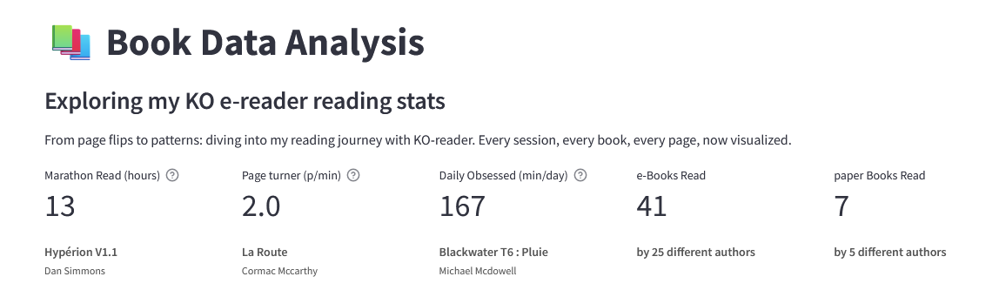
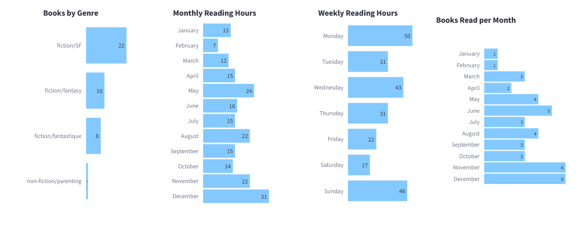
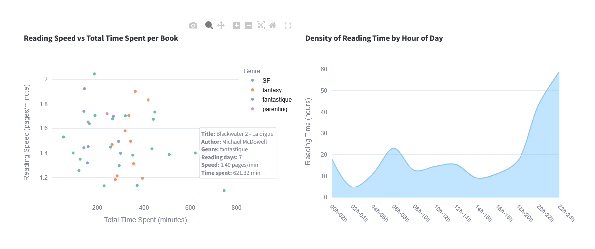
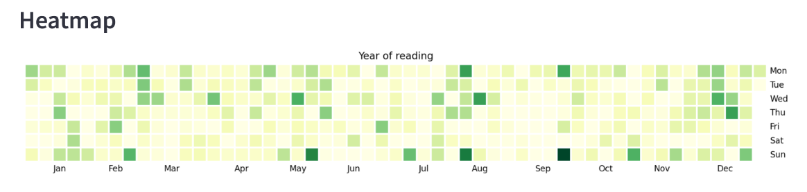
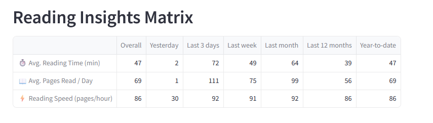
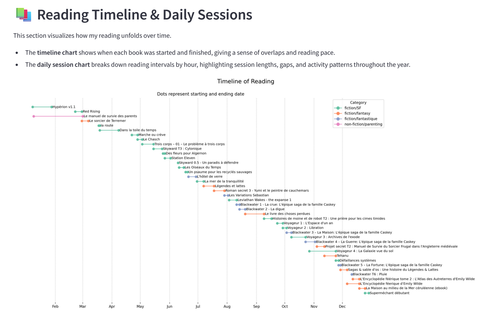
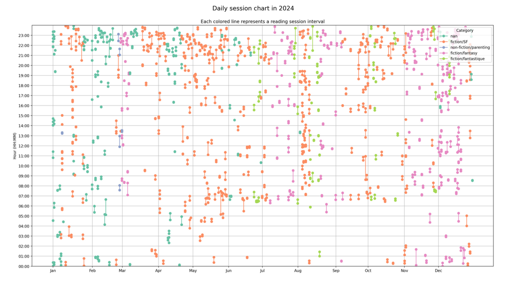

# 📚 KO-log: My E-Reading Habit Data Pipeline & Dashboard

A personal analytics project to explore and visualize my reading habits. This repository combines **Python**, **pandas**, **Streamlit**, and **Parquet-based data processing** to provide insights into books, reading speed, and other statistics.

You can read the full story [on Substack!](https://chrsolv.substack.com/p/i-turned-my-kobo-reading-data-into).

You can [try the streamlit app here](https://book-data-geek-chrs-olv.streamlit.app/)


*All images are screenshots from the streamlit app*

---

## 🔍 Overview

We carry our books everywhere, but rarely do we see the data behind our reading habits. This project answers questions such as:

- How much do I really read?
- Which authors or series do I binge?
- Am I more of a sprinter or a marathon reader?

The workflow is structured into three main parts:

1. **Data Extraction & Transformation** (`3.transformations/scripts/extract-transform.py`)
   - Processes raw reading data and produces clean, structured datasets (`.parquet` files).
2. **Analytics & Visualization** (`4.app/app.py`)
   - Streamlit app to explore personal reading data through charts, KPIs, and tables.
3. **Experiments & Prototypes** (`4.app/pages/experiments.py`)
   - Interactive playground for testing new visualizations, calculations, or features before integrating them into the main app.





---

## 📂 Repository Structure

```text
book_data_analysis/
├─ 1.data/             # Raw and processed data
├─ 3.transformations/   # ETL scripts
├─ 4.app/              # Streamlit application
│  ├─ app.py           # Main app entry point
│  └─ pages/           # Extra pages (experiments, prototypes)
├─ README.md
├─ .gitignore
└─ requirements.txt
```



**Note:** All raw or sensitive data files are excluded from this repository. Demo files are provided to allow testing and exploring the app.

---

## ⚡ Quick Start

### 1. Clone the repository
```bash
git clone https://github.com/ChrisOlv/book_data_analysis.git
cd book_data_analysis
```
### 2. Create a Python virtual environment
```
python -m venv .venv
source .venv/bin/activate   # Linux / Mac
.venv\Scripts\activate      # Windows
```
### 3. Install dependencies
```
pip install -r requirements.txt
```

### 4. Run the Streamlit app
```
streamlit run 4.app/app.py
```
You should see the interactive dashboard in your browser.

If you do not have real data, the app will fallback to demo datasets (*_demo.parquet) to allow testing.

### Transform your reading data

Place your reader's `statistics.sqlite3` in `1.data/1.raw/sqlite/`, then run:

```bash
python 3.transformations/scripts/extract-transform.py
```

GPT enrichment of book categories and first publication dates is optional. Without a complete Azure OpenAI configuration, or if an API request fails, the transformation continues and exports the reading data. Existing and successfully generated values are retained; missing values remain empty and can be filled during a later run. A successful run also archives the input SQLite file.

To enable enrichment, install `python-dotenv` and `langchain-openai`, then set `AZURE_OPENAI_API_KEY`, `AZURE_OPENAI_ENDPOINT`, `AZURE_OPENAI_API_VERSION`, and `AZURE_OPENAI_DEPLOYMENT` in the environment or a local `.env` file. Never commit your credentials.

### 5. Generate the static HTML book list
```bash
python scripts/generate_static.py
```
This creates `output/booklist.html`, a static dark-mode page with a searchable and filterable table of books that can be hosted directly on a NAS without running Streamlit.




## 🛠️ Features

Reading analytics: visualize reading duration, speed, and category distribution.

Author & series tracking: identify favorite authors and series.

Interactive charts: powered by Plotly Express.

Experimentation page: try new ideas without affecting the main app.

Static HTML export: generate a standalone book list page for simple NAS hosting.



## 📖 Dependencies

* Python >= 3.10
* pandas
* pathlib
* Streamlit
* Plotly Express
(Full list in requirements.txt.)

## 📌 Notes

All sensitive or private reading data should never be committed. Use the _demo.parquet files for testing.

Contributions are welcome! Please follow the guidelines in CONTRIBUTING.md.


## 🚀 Next Steps

* Add unit tests for ETL scripts
* Expand Streamlit app with more KPIs
* Add automated CI/CD with GitHub Actions
* Improve data input workflow (e.g., automatic ingestion from e-readers)

## Screenshots


